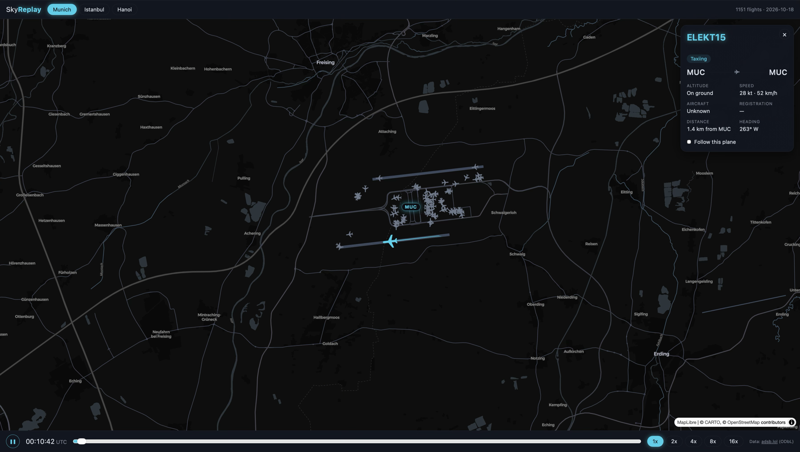

# SkyReplay

Replay one airport's full day of real flights as a timelapse: neon trails on a dark map, planes
taxiing to their gates, and the occasional go-around.



**Live demo:** https://ahmedozdogan.github.io/skyreplay/ (not deployed yet)

> **Status:** early and moving fast. V1 is mostly done; see the [roadmap](ROADMAP.md) and the open
> issues. Contributions are welcome, see [CONTRIBUTING.md](CONTRIBUTING.md).

## Features

- **A whole day at an airport:** Munich, Istanbul and Hanoi, from real ADS-B data.
- **Timelapse controls:** play/pause, a time slider, 1x–16x speed. Keyboard: `Space`, `1`–`5`.
- **Neon trails** that fade behind every aircraft, with a plane icon pointing where it's heading.
- **Parked planes** stay at their gates between flights.
- **Flight card:** click any plane for its callsign, airline, aircraft type, registration,
  altitude, speed and a live status ("On approach · lands in 3 min"). Tick *Follow this plane* to
  keep the camera on it.
- **GO AROUND!** Aborted landings are detected and announced as the replay plays through them.
- **Gap filling:** receivers often lose aircraft just above the runway; SkyReplay estimates the last
  bit of the landing or the start of the takeoff roll (and says so on the card).

## Tech stack

| Part | Built with |
|---|---|
| Web app | [React](https://react.dev) 19 + TypeScript, [Vite](https://vite.dev) |
| Map | [MapLibre GL](https://maplibre.org) via [react-map-gl](https://visgl.github.io/react-map-gl/), free [CARTO](https://carto.com/basemaps) dark basemap (no API key) |
| Trails and planes | [deck.gl](https://deck.gl) (`TripsLayer`, `IconLayer`) |
| Styling | [Tailwind CSS](https://tailwindcss.com) 4 |
| Data pipeline | Python 3.11+, standard library only |
| Quality | [Biome](https://biomejs.dev) (TS lint/format), [Vitest](https://vitest.dev), [Ruff](https://docs.astral.sh/ruff/), [pytest](https://pytest.org) |
| Hosting | Static files on GitHub Pages: no backend, no database |

## How it works

```
adsb.lol daily dump  ──►  pipeline/process.py  ──►  MUC-2026-10-18.json.gz  ──►  browser
 (~3.5 GB, worldwide,       keep planes near the       (< 1 MB per airport,         React + MapLibre +
  streamed, never saved)    airport, split into        static file)                 deck.gl replay
                            flights, resample to 5 s
```

The pipeline runs once per airport-day. It streams the worldwide dump without saving it, keeps only
aircraft within 50 km of each airport and below 15,000 ft, and writes one small file per airport.
The browser loads that file and does the rest: positions, parking, go-arounds and gap filling.

File formats are documented in [docs/data-format.md](docs/data-format.md).

## Quick start

You need Node 24 (see `web/.nvmrc`) and Python 3.11+.

Run the site. Until you process a real day, Munich shows a few sample flights:

```sh
cd web
npm install
npm run dev
```

Process a real day (streams ~3.5 GB once, takes a few minutes):

```sh
cd pipeline
python3 -m venv .venv && source .venv/bin/activate
pip install -e '.[dev]'
python process.py --airport MUC IST HAN --date 2026-10-18
```

Run the checks:

```sh
cd pipeline && ruff check . && pytest
cd web && npm run lint && npm test && npm run build
```

## Project structure

```
pipeline/     Python: daily dump → one .json.gz per airport-day
web/src/
  components/ React UI (Header, Footer, TimeBar, FlightCard, …)
  map/        MapLibre map and deck.gl layers
  hooks/      playback clock, data loading, go-around alerts
  flights/    pure flight logic with unit tests
docs/         data format, screenshot
```

More detail in [CONTRIBUTING.md](CONTRIBUTING.md#project-structure).

## Contributing

Ideas, bug reports and pull requests are welcome. Please **comment on an issue before starting a
feature**, so we can agree on the approach first. Issues labelled `good first issue` are a good place
to start. See [CONTRIBUTING.md](CONTRIBUTING.md) for setup, tests and PR guidelines, and the
[Code of Conduct](CODE_OF_CONDUCT.md).

## Data and license

Data: [adsb.lol](https://adsb.lol) (ODbL). Flight data comes from adsb.lol under the
[Open Database License](https://opendatacommons.org/licenses/odbl/1-0/). Published data files
(`*.json.gz`) are derived databases and stay under ODbL, and the app must keep the "Data: adsb.lol
(ODbL)" credit.

The code is [MIT](LICENSE). Map data © [OpenStreetMap](https://www.openstreetmap.org/copyright)
contributors, basemap © CARTO.
