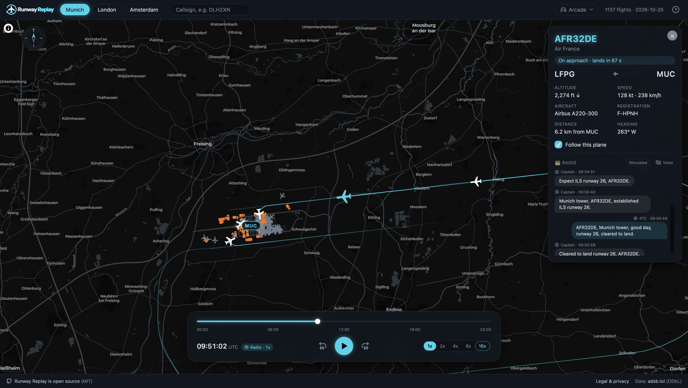
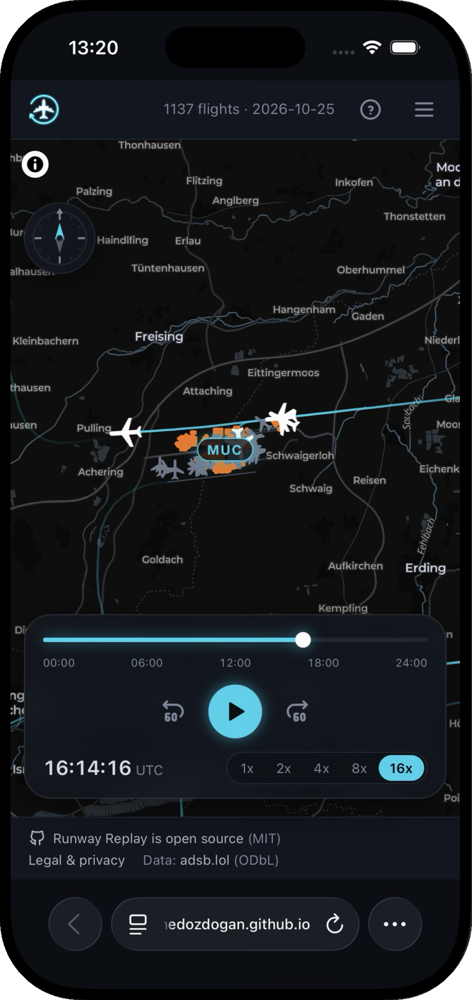

<div align="center">


### Replay one airport's full day of real flights as a timelapse

Neon trails on a dark map, planes taxiing to their gates, simulated ATC radio — and the occasional go-around.<br>
No backend, no database, no API keys: one static site and one nightly data file.

[](https://github.com/AhmedOzdogan/runway-replay/actions/workflows/ci.yml)
[](https://github.com/AhmedOzdogan/runway-replay/actions/workflows/data.yml)
[](LICENSE)
[](https://opendatacommons.org/licenses/odbl/1-0/)
[](CONTRIBUTING.md)

[](https://react.dev)
[](https://www.typescriptlang.org)
[](https://vite.dev)
[](https://deck.gl)
[](https://maplibre.org)
[](https://tailwindcss.com)
[](https://www.python.org)

**Live demo:** https://ahmedozdogan.github.io/runway-replay/





</div>

> **Status:** early and moving fast. V1 is mostly done — see the [roadmap](ROADMAP.md) and the open
> issues. Contributions are welcome: start with [CONTRIBUTING.md](CONTRIBUTING.md).

## 🎯 Why this exists

Flight trackers show you *now*. Runway Replay shows you a **whole day at once**: the morning
departure bank, the midday lull, the evening arrival rush, every taxi route and every aborted
landing — compressed into a few minutes you can scrub through.

It is also an open, readable portfolio project: real public data, a deliberately small Python
pipeline (standard library only), and a browser app that renders thousands of positions per frame.
Everything runs statically, so the whole thing costs nothing to host and can be forked for any
airport.

## ✨ Features

- **✈️ A whole day at an airport** — Munich, London Heathrow and Amsterdam, from real ADS-B data.
- **⏯️ Timelapse controls** — play/pause, time slider, ±1 minute, 1x–16x speed. Keyboard: `Space`, `1`–`5`.
- **💫 Neon trails** that fade behind every aircraft, with a plane icon pointing where it's heading.
- **🅿️ Parked planes** stay at their gates between flights, and **ground vehicles** (tractors,
  mowers, fire trucks) show up as small orange trucks.
- **🪪 Flight card** — click any plane for its callsign, airline, aircraft type, registration,
  altitude, speed and a live status ("On approach · lands in 3 min"). Tick *Follow this plane* to
  keep the camera on it.
- **🔁 GO AROUND!** — aborted landings are detected and announced as the replay plays through them.
- **📻 Simulated ATC radio** — the flight card shows the conversation between the captain and ATC for
  each arrival, departure and go-around, written like a real transcript ("Cleared to land 36,
  THY7JK"). Messages use the flight's real callsign, runway, altitude and heading; the wording is
  simulated.  The replay slows to 1x while the radio talks.
- **🔊 HD radio voice (optional)** — switch it on in the radio panel to hear the conversation, spoken
  by the open-source Kokoro voice model running in your browser, through an aircraft-radio filter.
- **🗺️ Where each flight went** — a departure's destination is worked out by following the same
  aircraft through the rest of the worldwide dump, along with how long it stayed in the air.
- **🎯 Arcade: guess the destination** — one game a day. A flight leaves, you get a minute and the
  clues a spotter would use (aircraft, cabin, weight class, time airborne, altitude, heading) to
  say where it's going, while the replay follows it across the map.
- **🧭 Compass** — the map rotates with two fingers; the compass turns with it and puts north back.
- **🩹 Gap filling** — receivers often lose aircraft just above the runway; Runway Replay estimates
  the last bit of the landing or the start of the takeoff roll (and says so on the card).
- **📱 Works on phones** — the time bar becomes a floating media-player panel.

## 🧰 Tech stack

| Part | Built with |
|---|---|
| Web app | [React](https://react.dev) 19 + TypeScript, [Vite](https://vite.dev) |
| Map | [MapLibre GL](https://maplibre.org) via [react-map-gl](https://visgl.github.io/react-map-gl/), free [CARTO](https://carto.com/basemaps) dark basemap (no API key) |
| Trails and planes | [deck.gl](https://deck.gl) (`TripsLayer`, `IconLayer`) |
| Radio voice | [Kokoro-82M](https://huggingface.co/onnx-community/Kokoro-82M-v1.0-ONNX) via [kokoro-js](https://www.npmjs.com/package/kokoro-js), in a Web Worker, plus the Web Audio API |
| Styling | [Tailwind CSS](https://tailwindcss.com) 4 |
| Data pipeline | Python 3.11+, standard library only |
| Quality | [Biome](https://biomejs.dev) (TS lint/format), [Vitest](https://vitest.dev), [Ruff](https://docs.astral.sh/ruff/), [pytest](https://pytest.org) |
| Hosting | Static files on GitHub Pages: no backend, no database |

## ⚙️ How it works

```
adsb.lol daily dump  ──►  pipeline/process.py  ──►  MUC-2026-10-18.json.gz  ──►  browser
 (~3.5 GB, worldwide,       keep planes near the       (< 1 MB per airport,         React + MapLibre +
  streamed, never saved)    airport, split into        static file)                 deck.gl replay
                            flights, resample to 5 s
```

The pipeline runs once per airport-day. It streams the worldwide dump without saving it, keeps only
aircraft within 50 km of each airport and below 15,000 ft, and writes one small file per airport,
plus `latest.json` naming the day. The browser loads that file and does the rest: positions,
parking, go-arounds and gap filling.

**Daily update:** every night at 04:30 UTC, a GitHub Action (`.github/workflows/data.yml`) processes
yesterday once adsb.lol has published it and adds the files to the `data` branch, which keeps every
day processed so far plus an `index.json` listing them. The deployed site carries only the newest
day; older days stay on the branch until the date picker can load them.

File formats are documented in [docs/data-format.md](docs/data-format.md).

## 🔄 CI/CD

| Branch | What it is |
|---|---|
| `develop` | where work lands: every feature and fix is merged here by pull request |
| `main` | production: what the live site serves |
| `data` | the processed day, force-pushed nightly by the data workflow (no code) |

- **CI** (`.github/workflows/ci.yml`) runs Ruff, pytest, Biome, Vitest and the production build on
  every pull request and on every push to `main` and `develop`.
- **CD** (`.github/workflows/pages.yml`) waits for CI to pass on `main`, rebuilds the site with the
  newest day copied in from the `data` branch, and deploys it to GitHub Pages. A red build never
  reaches the live site.
- The nightly data run triggers the same deploy, so the site follows the newest day without a code
  change.

Both branches are protected: changes arrive by pull request, with CI green.

## 🚀 Quick start

You need **Node 24** (see `web/.nvmrc`) and **Python 3.11+**.

**1. Run the site.** Until you process a real day, Munich shows a few sample flights:

```sh
cd web
npm install
npm run dev
```

**2. Process a real day** (streams ~3.5 GB once, takes a few minutes):

```sh
cd pipeline
python3 -m venv .venv && source .venv/bin/activate
pip install -e '.[dev]'
python process.py --airport MUC LHR AMS --date 2026-10-18
```

**3. Run the checks** (CI runs the same on every pull request and push):

```sh
cd pipeline && ruff check . && pytest
cd web && npm run lint && npm test && npm run build
```

## 🗂️ Project structure

```
pipeline/     Python: daily dump → one .json.gz per airport-day
web/src/
  components/ React UI (Header, Footer, TimeBar, FlightCard, RadioTranscript, …)
  map/        MapLibre map, deck.gl layers, compass
  hooks/      playback clock, data loading, go-around alerts, radio voice, the arcade game
  arcade/     the games, one folder each (guessDestination: rounds, options, scoring)
  flights/    pure flight logic (positions, go-arounds, ground vehicles, radio conversation…)
  sound/      HD radio voice: Kokoro in a Web Worker, aircraft-radio audio effect
  data/       airports, airline and aircraft names, radio phrases
web/tests/unit/  Vitest unit tests, mirroring web/src/
docs/         data format, screenshots
```

More detail in [CONTRIBUTING.md](CONTRIBUTING.md#project-structure).

## 🤝 Contributing

Ideas, bug reports and pull requests are welcome.

1. Pick an issue — `good first issue` is a good place to start, or open one for your idea.
2. **Comment on it before you start**, so we can agree on the approach first.
3. Branch from **`develop`** (`feat/…`, `fix/…`, `docs/…`) and keep the checks above green.
4. Open a PR **into `develop`** with a one-line summary of what changed and why.

`main` is production and only ever receives `develop` by pull request, so nothing goes live before
CI is green.

[CONTRIBUTING.md](CONTRIBUTING.md) has the setup, test and PR details; please also read the
[Code of Conduct](CODE_OF_CONDUCT.md).

## 🔒 Privacy and downloads

Runway Replay has no backend, no accounts and no tracking. The page loads the map tiles (CARTO) and
the day's flight file. The **HD radio voice is off by default**: switching it on downloads the Kokoro
voice model (~90 MB) once from **huggingface.co**, after which the browser caches it. Speech is
generated on your device; nothing you do is sent anywhere.

## 📄 Data and license

Data: [adsb.lol](https://adsb.lol) (ODbL). Flight data comes from adsb.lol under the
[Open Database License](https://opendatacommons.org/licenses/odbl/1-0/). Published data files
(`*.json.gz`) are derived databases and stay under ODbL, and the app must keep the "Data: adsb.lol
(ODbL)" credit.

The code is [MIT](LICENSE). Map data © [OpenStreetMap](https://www.openstreetmap.org/copyright)
contributors, basemap © CARTO. The Kokoro voice model is
[Apache-2.0](https://huggingface.co/onnx-community/Kokoro-82M-v1.0-ONNX).
